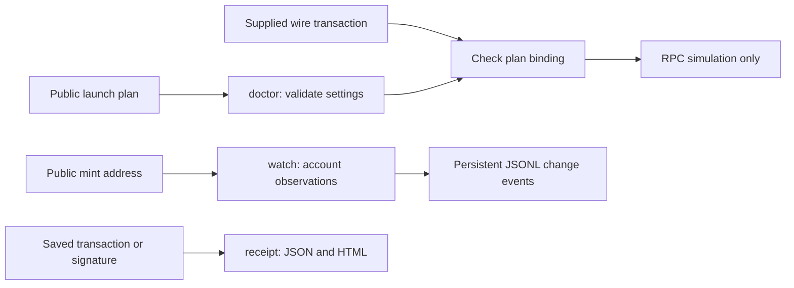
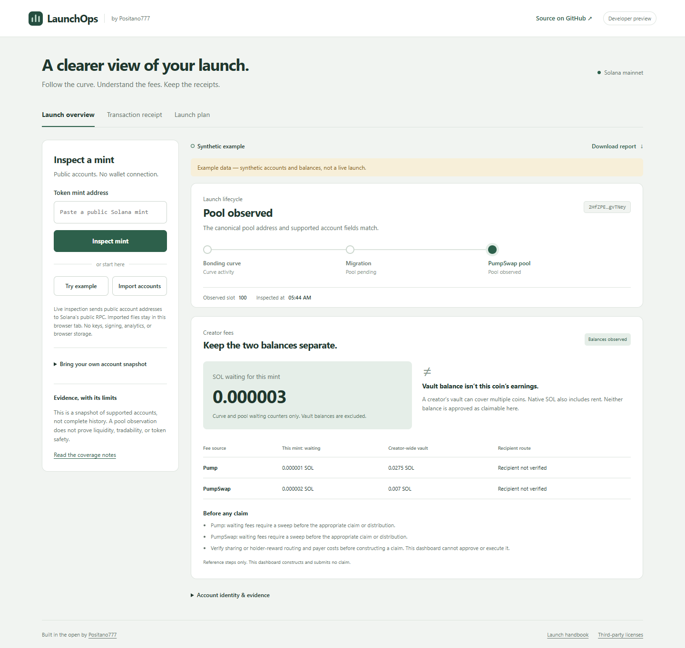

# Memecoin LaunchOps

**Prepare the plan. Observe the launch. Publish the receipts.**

An independent MIT community project by [Positano777](https://x.com/positano777), connecting the [launch handbook](https://github.com/Positano777/memecoin-launch-handbook), compatibility checks, and [transaction receipts](https://github.com/Positano777/pumpfun-community-tools/tree/main/receipt).

**Developer preview.** This release inspects public plans, checks supplied creation transactions, performs RPC simulations, and observes public accounts. It does not sign, broadcast, create a coin, buy/sell, or deliver messages to external services. A browser dashboard is included; its hosted preview starts owner-private. It is not affiliated with Pump or Solana.

| Command | Useful result | Coverage |
|---|---|---|
| `doctor` | Find invalid settings; compare a supplied create transaction with the plan; optionally simulate it | Mainnet Pump `create_v2`, SOL/USDC quotes, creation-only legacy or v0 without lookup tables |
| `watch` | JSONL events when observed lifecycle changes, with persistent state and retryable pending events | Point-in-time RPC polling of a mint, curve, and canonical SOL/USDC pools |
| `receipt` | Wallet SOL change, network fee, supported transfers, token changes, unexplained residual | Pinned reuse of our existing conservative receipt runtime |
| `fees` | Per-mint waiting counters, separate creator-wide vault balances, conditional sweep/claim route hints | Read-only SOL/USDC account snapshot; no claimability or lifetime-income calculation |



## Browser dashboard

[Dashboard source and setup](dashboard/README.md) provides launch lifecycle observations, separate waiting/vault fee balances, local account imports, transaction receipts, and offline launch-plan checks. Serve the checked-in `dashboard/dist/` without installing dependencies. Demo data is labeled synthetic. Live public RPC can deny browser requests; imports work locally. The dashboard does not execute launches or claims. Use the **Launch plan** tab to check settings and export a public plan; use [CLI snapshots](docs/SNAPSHOTS.md) to import real account observations when browser RPC is blocked.



## Start offline

Node.js **22.18 or later**. Clone this repository, then:

```sh
npm ci --ignore-scripts
npm test
node bin/launchops.mjs --help
node bin/launchops.mjs doctor --plan examples/plan.synthetic.json
node bin/launchops.mjs watch --mint 2HfZPEuc9b8ujLaJ3HEXFPhSCQQvmQBB92W5HegvTNey --snapshot examples/accounts.active.synthetic.json
```

The example public mint above matches `examples/plan.synthetic.json`. All examples are invented, including the metadata URI and account balances. Their public points were generated without signing keys; do not fund them. The supplied wire transaction has empty signatures and is not a live launch. The offline examples request no network access.

For an actual mint, `watch` defaults to one live poll:

```sh
node bin/launchops.mjs watch --mint PUBLIC_MINT
node bin/launchops.mjs watch --mint PUBLIC_MINT --follow --interval 30
node bin/launchops.mjs watch --mint PUBLIC_MINT --polls 3 --interval 15 --state .launchops/my-watch.json
```

Default endpoint: public Solana mainnet RPC. Set `SOLANA_RPC_URL` in the environment for your provider; `.env` files are not automatically loaded. Provider rate limits, data availability, and hosting costs apply. Never put credential-bearing RPC settings into plans or reports. RPC uses HTTPS or local loopback HTTP, refuses redirects, times out after 20 seconds, and caps responses at 5 MB. The live observer checks the provider's reported mainnet genesis hash, then requests one coherent six-account batch at `confirmed` commitment. This is provider evidence, not independent blockchain verification.

## Doctor: inspect before signing

Make a copy of `examples/plan.synthetic.json`, replacing its public fields. The supported schema is deliberately small: public creator, payer and new mint, name, symbol, metadata URI, mode flags, quote asset, and integer budget. Unknown fields, credentials, deprecated cashback, unsupported modes/pairs, zero/reused mint keys, malformed URLs and amounts are rejected. Current creation uses Token-2022.

```sh
node bin/launchops.mjs doctor --plan my-public-plan.json --out new-doctor-report.json
node bin/launchops.mjs doctor --plan my-public-plan.json --transaction my-unsigned-creation.base64 --out new-simulation-report.json
```

`--transaction` is a file containing a serialized base64 Solana wire transaction, at most 1232 bytes. Export it from your transaction-building workflow. The preview does not build or sign one. It checks the fee payer/signer set, exact supported creation accounts and parameters against the plan, and allows only one `create_v2` plus supported Compute Budget instruction layouts. Additional transfers, buys, programs, unsupported trailing data, and address lookup tables are refused by this limited profile. Refusal does not mean another transaction format is malicious; it means this tool cannot review it.

Only after those checks does it request `simulateTransaction` with `sigVerify:false` and `replaceRecentBlockhash:true`. Simulation does not charge an on-chain transaction fee or broadcast the transaction. It sends the supplied transaction to your configured RPC provider. Do not include secrets in its instruction data.

`plan_checks_passed` means the supported offline checks passed. `simulation_succeeded` means the provider reported successful hypothetical execution. Neither means safe or ready to launch. The metadata content/image is not fetched or verified, the budget is neither an enforced cap nor a verified balance, and signatures are not verified. The account profile follows the documented interface; it does not certify deployed executable provenance or future compatibility.

## Watch: interpret evidence correctly

| Lifecycle | What was observed |
|---|---|
| `curve_active` | Correctly owned/discriminated curve prefix has `complete=false` |
| `migration_pending` | Complete curve with supported quote; its checked canonical pool is absent |
| `pool_observed` | Canonical pool address, owner, discriminator, index, authority, base and quote prefix match |
| `not_observed` | Mint and all checked derived accounts are absent in this response |
| `unknown` | Unavailable, stale, contradictory, malformed, or unsupported evidence |

An observed pool is not proof trading is enabled, liquidity is sufficient, or a token is safe. Migration pending is not a diagnosis of a stuck migration. Not observed does not prove a coin never existed. Legacy curves missing the quote field do not get an assumed SOL quote when classifying pending migration. Only canonical SOL/USDC pools are queried; other quote configurations have partial coverage.

The tool checks known account prefixes, not every appended field or token extension. It does not monitor prices, holders, wallets, bundles, or complete transaction history. Polling and downtime can miss transient lifecycle states. Every event states `historyBackfilled:false` and `independentlyVerified:false`.

State is stored by mint in `.launchops/` unless `--state` is supplied. Unchanged status/reason is quiet, including after restart. Unknown evidence generates an explicit change event rather than a false absence. Slots cannot rewind. Each event has a stable deduplication ID and sequence.

Pending events are saved before stdout delivery and acknowledged after it. Delivery is **at least once**: a crash between delivery and acknowledgment may repeat the same ID. Consumers should deduplicate it. Atomic rename plus file fsync protects normal process restart; power-loss guarantees depend on the filesystem. One watcher holds an exclusive lock per state file. After a hard kill, confirm the old process stopped before removing its stale `.lock` file. Corrupt or foreign state is refused without overwriting it. No automatic historical replay or Telegram/webhook delivery is implemented.

## Creator fee report

```sh
node bin/launchops.mjs fees --mint PUBLIC_MINT --out new-fee-report.json
node bin/launchops.mjs fees --mint 2HfZPEuc9b8ujLaJ3HEXFPhSCQQvmQBB92W5HegvTNey --snapshot examples/fees.synthetic.json
```

The new `fees` command separates this mint's waiting curve/pool counters from creator-wide vault balances. It never adds those vault balances into the coin's earnings. Native vault SOL is a gross balance including rent; token vault amounts use integer raw quote units. Missing fee fields remain unknown. The same creator can receive fees from many coins.

The live reader discovers recipient addresses, then re-fetches the base accounts and required vaults in one coherent confirmed batch. Recipient/quote changes or regressing slots cause refusal. Holder rewards and program/shared recipients are marked for route review. The report describes conditional sweep-before-claim/distribution steps; it neither verifies entitlement nor builds, signs, or submits a claim. See [fee-report details](docs/FEES.md).

## Bring live accounts into the browser

```sh
node bin/launchops.mjs fees --mint PUBLIC_MINT --snapshot-out new-accounts.json
```

Then choose **Import accounts** in the dashboard. This reads the provider configured in your CLI environment and exports projected public account fields. Provider settings, URLs and diagnostics are not copied to the snapshot. `--snapshot-out` is separate from interpreted `--out` reports and refuses existing files. Imports remain unverified files; they do not prove network origin. See [snapshot coverage and limits](docs/SNAPSHOTS.md).

## Receipt: reuse the existing tool

```sh
node bin/launchops.mjs receipt --wallet PUBLIC_WALLET --file saved-getTransaction.json --out new-receipt
node bin/launchops.mjs receipt --wallet PUBLIC_WALLET --signature PUBLIC_SIGNATURE
```

The receipt supports compiled RPC `json`, not `jsonParsed` or serialized base64 transaction responses. It preserves exact integer amounts and reports unsupported movements as unexplained. It is not full PnL. See [upstream coverage](https://github.com/Positano777/pumpfun-community-tools/blob/20916fc2391326e5b9b69b1863c82fac02d1088a/receipt/README.md) and [vendored provenance](vendor/receipt/PROVENANCE.json). Existing output paths are refused.

## Validation, attribution and limits

See [VALIDATION.md](VALIDATION.md), [SECURITY.md](SECURITY.md), and [SOURCES.md](SOURCES.md). The dependency audit reports moderate advisories in installed transitive packages; no high/critical findings were reported at review. This is not an audited production launch service.

We reuse `@solana/web3.js` for public keys, PDA derivation and wire transaction parsing. The receipt runtime retains original MIT and VTX Labs/bs58/base-x notices. The official Pump SDK was inspected as an interface reference but is not installed, vendored or redistributed: its package declares MIT, while license text could not be verified in its archive/repository. Current proprietary nirholas packages are excluded. Public interface facts are implemented in a small, independently authored checker; the Pump SDK itself is not copied.

## Contribute

Useful contributions: sanitized failed-creation fixtures, independent account-layout checks, recorded migration observations with explicit coverage, and dependency improvements that preserve compatibility. Never submit private keys, recovery phrases, RPC credentials, or unsanitized logs. Reproduce with `npm test`; examples regenerate with `node scripts/make-examples.mjs`.

Next candidates are claim-transaction compatibility checks, metadata-content checks, and a signing adapter reviewed separately. These are proposals, not implemented capabilities. MIT; retain the notices under `vendor/`.
