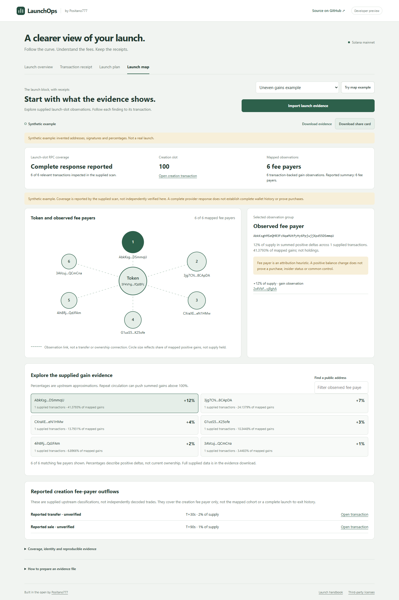
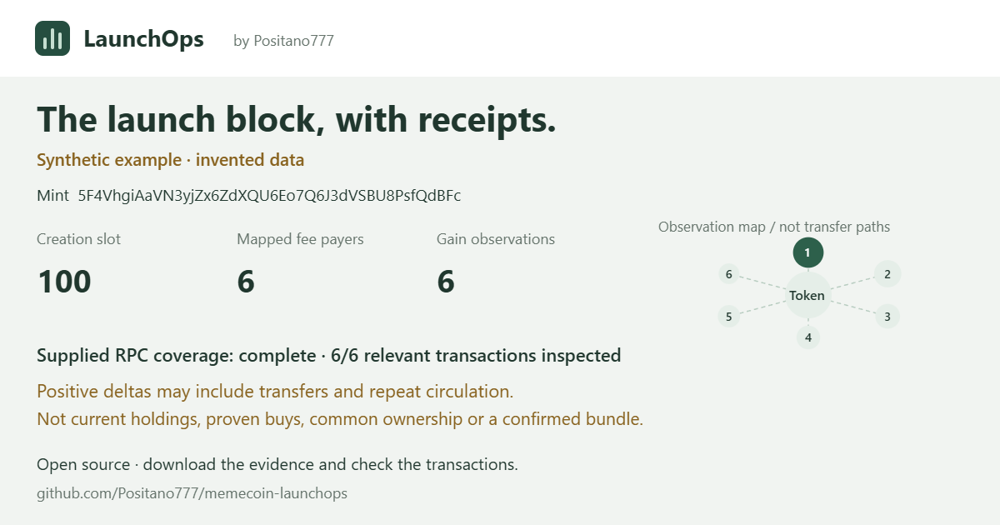

# Launch map preview

This is the first stage of the launch-to-exit project: an offline viewer of supplied launch-slot evidence. It is **not yet a full whale tracker**, token-holder concentration analysis, live indexer or complete launch-to-dump trace.

## Use the viewer

LaunchOps → Launch map → try an example or import a JSON file (maximum 5 MB). No wallet connection, RPC request, new dependency or browser storage is needed for this view. The existing dashboard logo and palette are preserved.

- Select a circle or wallet button to inspect its supplied transactions.
- Filter the list by public address. The map shows the first eight groups; the list shows up to 50 matches. Full supplied rows remain in the JSON.
- Download projected evidence JSON or a 1200×630 branded PNG. The card retains source, coverage and key interpretation limits. Imported data remains unverified.
- Three synthetic scenarios demonstrate uneven gains, distributed gains and incomplete sampling. Addresses and signatures are fabricated public examples, not signing keys or live findings.
- A saved mainnet case deliberately has zero mapped observations. It demonstrates an honest empty result, not a safe token or proof of no purchases.





## Evidence input and CLI

Accepts `positano.launch-evidence.v1` exports and saved token-scan JSON from our [community-tools fork](https://github.com/Positano777/pumpfun-community-tools). The existing MIT export formatter is vendored at its pinned community commit; provenance hashes and original copyright are retained under `vendor/launch-evidence/`.

```sh
node bin/launchops.mjs launch-map --file examples/launch-map.synthetic.json --out new-map-evidence.json
node bin/launchops.mjs launch-map --file saved-token-scan.json --out new-map-evidence.json
```

This command is offline, uses the same validation/projection as the viewer and refuses existing output files. To create an export in the community-tools checkout, use its `node evidence/cli.mjs scan.json evidence.json` workflow. This viewer does not run the upstream application or fetch arbitrary mint history. Old textual `SYNTHETIC_*` address/signature placeholders are deliberately rejected; use the valid public-point example shipped here.

Only known fields are retained. Public addresses/signatures, bounded lists, amounts and internally consistent coverage are validated. Provided URLs are ignored and rebuilt from signatures. Raw provider diagnostics, unknown fields and arbitrary imported prose are omitted. This limits disclosure; it is not a guarantee that files contain no secrets. Check input before sharing.

## Read the graph correctly

The upstream sampler records **positive fee-payer token deltas**, not all token recipients. It excludes the creation transaction itself, so creation-transaction allocations are not mapped. A fee payer can be a service and need not be the actual buyer. The creation fee payer is not established as the token creator.

Dashed lines connect the token to observations. They are **not funding or wallet-to-wallet transfer edges**. Circle size reflects the share of mapped gross positive gains, not token supply held. Token transfers and repeated circulation can make summed gains exceed 100%. These data cannot establish unique supply concentration, common control, insider status, purchases or Jito membership. The UI does not produce a risk/safety score.

Complete coverage means the supplied scan reports a complete provider response for its defined relevant-transaction sample. It is not independently verified here and does not mean complete ownership, trade or outflow history. Imported coverage denominators are checked for internal consistency, not against the chain.

The optional outflow list contains upstream classifications for the **creation fee payer only**. Each row is labeled reported/unverified. The viewer does not independently decode sales, follow mapped wallets, infer exits from absent holdings, compute PnL or provide reliable exact intrablock timestamps.

## Mainnet example validation

Saved mint `9U32MnGjepKLPFwGPgJUppiNhFemGa3JSho329qWpump`, creation slot **455522726**, creation transaction `3DsFpAxFbw8rHXRK6jyT69PZQfnJhV74pBP1JmEV4tjb3caBKMnh6PJw3qgrvmB7f9FFW92f8kMNwWWG1auiF4cr`.

On 2026-10-22, separate read-only `getTransaction`/`getBlock` calls using public mainnet RPC re-established a successful creation transaction with the matching mint initialization and Pump invocation. The block contained that transaction, zero additional relevant transactions under the sampler's mint/account-balance relevance rules, and no missing transaction metadata. This confirms one zero-observation case, not whale ownership, execution provenance, completeness of all possible token behavior or absence of a creation buy. The viewer remains offline and labels the saved case unverified here.

## Next stages

1. Supported creation-transaction allocations and token-account-owner attribution, with source transaction fixtures.
2. A bounded historical collector tracking the selected token and early cohort through explicit transfers and decoded buys/sells, including migration and visible missing-history ranges.
3. New significant holders, bounded multi-hop expansion and optional live notifications after archival coverage, decoding correctness, cost, persistence and reorg handling are validated.

None of these future capabilities is represented as shipped by the current map. Full-chain indexing and publicly accessible live service operations require separate infrastructure and cost validation. The hosted preview keeps its existing private audience.
